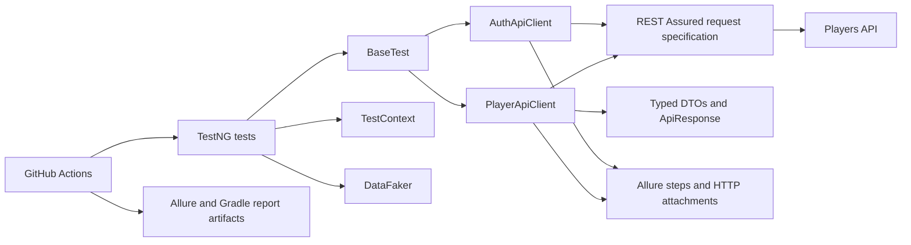

# Players API Automation Framework

[](https://github.com/YauheniPo/players_api_automation/actions/workflows/tests_run_ci.yml)

A Kotlin REST API automation framework that exercises an authenticated player-management workflow end to end. It demonstrates layered API clients, typed DTOs, parallel test-data creation, Allure reporting, and GitHub Actions CI.

## What this project demonstrates

- **Kotlin-first test design:** typed request/response DTOs and a sealed `ApiResponse` model make successful and failed HTTP responses explicit.
- **Maintainable API layer:** test classes express business flows while reusable clients own REST Assured configuration, authentication, request construction, and Allure steps.
- **Reliable test data:** DataFaker produces unique players; a thread-safe context tracks them for deterministic cleanup.
- **End-to-end workflow coverage:** authenticate, create 12 players in parallel, read, sort, delete, and verify that created records are gone.
- **Delivery feedback:** GitHub Actions runs the suite on pull requests and `main`, then uploads Allure results and Gradle test reports as artifacts.

## Architecture



For component responsibilities and the test lifecycle, see [architecture.md](docs/architecture.md).

## Quick start

### Prerequisites

- JDK 17
- A reachable Players API environment and valid test credentials
- Allure CLI (optional, to open results locally)

Create `src/main/resources/config.local.properties` from this template. The file is ignored by Git.

```properties
base.url=https://your-environment.example.com
admin.login=your-email@example.com
admin.password=your-password
```

Run the complete suite:

```bash
./gradlew test
```

Or pass configuration without writing a local file:

```bash
./gradlew test \
  -Dbase.url=https://your-environment.example.com \
  -Dadmin.login=your-email@example.com \
  -Dadmin.password=your-password
```

Run a single class while developing:

```bash
./gradlew testSingle --tests "com.automation.tests.AuthTest"
```

## CI and reports

The workflow runs for pull requests and pushes to `main`. It reads `BASE_URL`, `ADMIN_LOGIN`, and `ADMIN_PASSWORD` from GitHub Actions secrets, executes `./gradlew test`, and retains the following artifacts for seven days:

- `allure-results` — request/response-aware Allure result files;
- `test-reports` — Gradle HTML test report.

Open a local Allure report after a run:

```bash
allure serve build/allure-results
```

### Sample report flow

The Allure report presents one business flow rather than a collection of raw HTTP calls:

```text
Player Management
  ├─ POST /create × 12
  ├─ POST /getOne
  ├─ GET  /getAll
  ├─ DELETE /deleteOne/{id} × 12
  └─ GET  /getAll — verify created players are absent
```

## Project structure

```text
src/
├── main/kotlin/com/automation/
│   ├── api/       # REST Assured clients and ApiResponse mapping
│   ├── config/    # type-safe Owner configuration
│   ├── dto/       # request and response models
│   └── utils/     # test-data generation and thread-safe context
└── test/kotlin/com/automation/
    ├── base/      # suite setup and authentication
    └── tests/     # authentication and player CRUD workflows
```

## Design notes

- [Architecture](docs/architecture.md) — components, data flow, and execution lifecycle.
- [Engineering decisions](docs/design-decisions.md) — trade-offs behind the API layer, test orchestration, data isolation, and configuration.
- [Kotlin Multiplatform roadmap](docs/kmp-roadmap.md) — a future direction, not a current project capability.

## Development

```bash
./gradlew ktlintCheck
./gradlew ktlintFormat
./gradlew test
```

Open an issue for questions or improvements.
