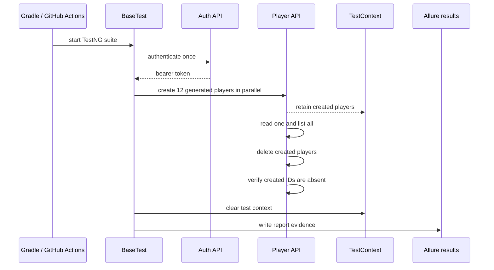

# Architecture

## Goal

The framework keeps test scenarios focused on product behaviour while shared infrastructure owns transport, authentication, configuration, reporting, and cleanup.

## Components

| Component | Responsibility |
|---|---|
| `AuthTest` and `PlayerTest` | Describe authentication and player CRUD behaviour. |
| `BaseTest` | Authenticates once before the suite and creates API clients. |
| `AuthApiClient` and `PlayerApiClient` | Encapsulate endpoint paths, request construction, and Allure steps. |
| `BaseApiClient` | Creates consistent REST Assured request specifications, including the base URL, JSON content type, and bearer token. |
| DTOs and `ApiResponse` | Keep request/response mapping typed and make non-2xx responses explicit. |
| `DataGenerator` and `TestContext` | Generate isolated data and retain created records safely across parallel work. |
| Allure | Captures business steps and HTTP evidence for diagnosis. |

## Execution lifecycle

## Configuration flow

Configuration is loaded through Owner with this precedence:

1. environment variables;
2. JVM system properties;
3. `config.local.properties` for local development;
4. versioned `config.properties` defaults.

Credentials remain outside version control. GitHub Actions receives them from repository secrets and forwards them as JVM properties to the Gradle test worker.
